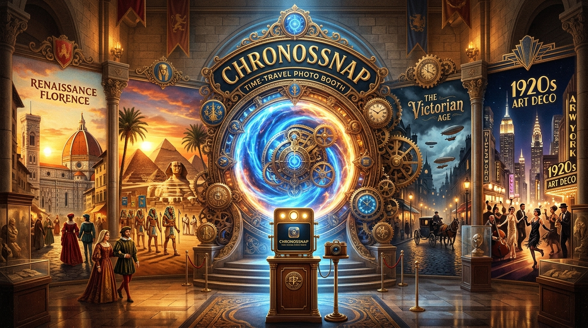

# ChronosSnap – Time-Travel Photo Booth ⏳📸



[](https://developer.mozilla.org/en-US/docs/Web/Progressive_web_apps)
[](https://ai.google.dev/)
[](https://ai.google.dev/)
[](https://www.paypal.com/donate/?business=luciferamorgenster%40gmail.com&no_recurring=0&currency_code=EUR)

> **ChronosSnap** is een interactieve *time-travel photo booth* webapplicatie en Progressive Web App (PWA). Maak een foto of upload een portret en transformeer jezelf naar iconische historische tijdperken met behulp van Google Gemini AI, pas authentieke vintage filters toe, exporteer virale transformatievideo's en beheer je projecten via een realtime creator dashboard.

---

## ☕ Support & Donaties (PayPal)

Vind je ChronosSnap geweldig en wil je bijdragen aan de verdere ontwikkeling, serverkosten voor AI-modellen of nieuwe historische tijdperken? Donaties worden enorm gewaardeerd!

* **PayPal Account:** `luciferamorgenster@gmail.com`
* **Directe Donatie Link:** [Doneer via PayPal](https://www.paypal.com/donate/?business=luciferamorgenster%40gmail.com&no_recurring=0&currency_code=EUR)
* **PayPal.Me Link:** [paypal.me/luciferamorgenster](https://www.paypal.me/luciferamorgenster)

---

## ✨ Belangrijkste Functionaliteiten

### 1. 📸 Live Photo Booth & Viewfinder
* **Live Webcam Capture:** 3-2-1 countdown timer, schermflits-effect en gesproken/audio sluiterklik.
* **Gezichtsuitlijning:** Ovale overlay voor optimale anatomische positionering.
* **Upload & Drag-and-Drop:** Ondersteuning voor JPEG, PNG en WebP afbeeldingen.
* **Kant-en-klare Voorbeeldportretten:** 4 diverse testportretten voor instant testen met één klik zonder webcam.

### 2. 🧠 Multimodale Gezichtsanalyse (`gemini-4-argon`)
* Diepgaande gezichtsanalyse van expressie, houding en belichtingshoeken.
* **Era Compatibility Score (bv. 96% Match):** Berekent welk tijdperk het beste bij je gelaatstrekken past.
* **Esthetisch Archetype:** Automatische classificatie (bv. *Renaissance Scholar*, *Pharaonic Noble*, *Steampunk Inventor*).
* **Historisch stijladvies & authentieke accessoires:** Kostuum- en rekwisietensuggesties voor maximale historische getrouwheid.

### 3. ⏳ Historische Tijdperk Transformatie (`gemini-nano-banana-2.1`)
Transformeer jezelf naar 10 gedetailleerde historische periodes:
1. **Renaissance Florence (1504 n.Chr.)** – Olieverfglazuur van Leonardo da Vinci en fluwelen gewaden.
2. **Oud-Egypte (1323 v.Chr.)** – Faraonische hofhouding met lapis lazuli kraag en gouden uraeus.
3. **Victoriaans Steampunk Londen (1888 n.Chr.)** – Messing tandwielen, gaslicht en koperen monocle.
4. **Roaring Twenties (1925 n.Chr.)** – Art Deco Gatsby balzaal met parels, veren en champagne.
5. **Romeinse Keizerrijk (80 n.Chr.)** – Patriciër met gouden lauwerkrans bij het Colosseum.
6. **Edo Japan Samurai (1680 n.Chr.)** – Traditionele zijden haori en kersenbloesems.
7. **Wild West Frontier (1875 n.Chr.)** – Verweerde lederen stofjas, sheriffsster en western saloon.
8. **Apollo Space Race (1969 n.Chr.)** – Maanpionier in NASA-ruimtepak en maanlander-cockpit.
9. **Versailles Rococo (1782 n.Chr.)** – Franse hofadel in de Spiegelzaal met pastelkleurige zijde.
10. **1980s Neon Cyberwave (1984 n.Chr.)** – Synthwave zonsondergang met spiegelbril en neonstraten.

* **Text Prompt Alchemy:** Typ gepersonaliseerde prompts om specifieke details toe te voegen of te wijzigen (bv. *"Voeg een gouden ketting en Rembrandt-belichting toe"*).
* **Resolutiekeuze:** 1K, 2K en 4K Ultra-Masterpiece export.

### 4. 🎨 Vintage & Sepia Darkroom Filters
* Realtime fotografische filters:
  * **Victorian Sepia (1890)** – Warme amberkleurige veroudering.
  * **Daguerreotype (1845)** – Monochroom zilverplaatproces met zware vignet.
  * **Silver Noir (1920)** – Diep orthochromatisch contrast.
  * **Kodachrome (1970)** – Warme filmkorrel en verzadigde goudtinten.
  * **Technicolor (1950)** – Levendige 3-strip pastelkleuren.
  * **Cyanotype (1880)** – Pruisisch blauwe zonneafdruk.
  * **Vivid Color (Modern)** – Schone digitale kleuren.
* Fijnregeling via schuifregelaars: Sepia-intensiteit, Filmkorrel, Vignet, Contrast en Helderheid.
* Authentieke fotolijsten: *Cabinet Card*, *Instant Polaroid*, *Gilded Museum Gold* en *Museum Plaque*.
* Interactieve **Before/After Split Slider** en Side-by-Side vergelijking.

### 5. 🎬 Virale Transformatie Video Studio
* Genereert een geanimeerde 9:16 verticale video van het tijdreisproces:
  * Fase 1: Originele foto met laserscanner & HUD tijdcoördinaten.
  * Fase 2: Kwantumtijdwarp vortex met versnellende jaartallenteller.
  * Fase 3: Naadloze overvloeiing en morphing naar het historische schilderij.
  * Fase 4: Gouden museumplaquette met jaartal en maker-watermerk.
* Exporteert direct als `.webm` videobestand, geoptimaliseerd voor TikTok, Instagram Reels en YouTube Shorts.

### 6. 📱 Progressive Web App (PWA) & Offline Modus
* **Volledig installeerbaar:** Direct te installeren op desktop, Android en iOS Safari via de in-app knop `Installeer App`.
* **100% Offline Werking:** Beschikt over een lokale canvas-synthesizer en filterengine waardoor je ook zonder internetverbinding historische portretten en video's kunt maken.
* **Service Worker Caching:** Automatische caching van alle statische assets, lettertypen en iconen.

### 7. 🌐 Social Media & OpenGraph Optimalisatie
* Volledig geoptimaliseerd voor **LinkedIn**, **Facebook**, **X (Twitter)**, **Pinterest** en **WhatsApp**.
* Bevat `og:image` (1200x675), Twitter Cards (`summary_large_image`), en Schema.org JSON-LD structured data.
* Directe deelfuncties met Web Share API, klembordkopieerfunctie en mobiele QR-code scanner.

### 8. 📊 Realtime Creator Dashboard & Projectbeheer
* **Statistieken:** Totaal aantal tijdreizen, geschatte virale weergaven, downloads, social shares en tijdlijn-badges.
* **Projectbeheer:** Meerdere actieve projecten beheren, hernoemen, dupliceren, favoriet maken en verwijderen.
* **Veilige Cloud Sync:** Realtime synchronisatiestatus met lokale-eerst persistentie.
* **Dark Mode & Steampunk Thema:** Keuze uit Dark Mode, Light Mode en Steampunk Brons.

---

## 🛠️ Technologie Stack

* **Frontend:** React 19, TypeScript, Tailwind CSS v4, Motion
* **Backend:** Node.js, Express, tsx
* **AI Modellen:**
  * `@google/genai` SDK
  * `gemini-4-argon` (Multimodale gezichtsanalyse & archetypen)
  * `gemini-nano-banana-2.1` (Tijdreis-beeldsynthese & prompt alchemy)
* **PWA & Offline:** `vite-plugin-pwa`, Service Worker, Web App Manifest
* **Media & Audio:** HTML5 Canvas, MediaRecorder API, Web Audio API, Canvas Confetti, Sharp

---

## 🚀 Lokale Installatie & Opstarten

### Vereisten
* Node.js (v18 of nieuwer)
* npm

### Stappen
1. Clone of open het project in de terminal:
   ```bash
   cd /app/applet
   ```
2. Installeer afhankelijkheden:
   ```bash
   npm install
   ```
3. Maak een `.env` bestand aan met je Gemini API sleutel:
   ```env
   GEMINI_API_KEY="JOUW_GEMINI_API_SLEUTEL"
   PORT=3000
   ```
4. Start de ontwikkelserver:
   ```bash
   npm run dev
   ```
5. Open je browser op `http://localhost:3000`.

---

## 📱 PWA Installeren

* **Google Chrome / Edge (Desktop & Android):** Klik op de knop **"Installeer App"** in de navigatiebalk of op het installatie-icoon in de adresbalk.
* **Safari op iPhone / iPad (iOS):** Tik op de **Deel-knop** onderaan in Safari en kies **"Zet op beginscherm"** (*Add to Home Screen*).

---

## 📄 Licentie

Gedistribueerd onder de Apache 2.0 Licentie.
Ontwikkeld voor creatieve makers, historici en tijdreizigers wereldwijd.
Donaties & support: [luciferamorgenster@gmail.com](https://www.paypal.com/donate/?business=luciferamorgenster%40gmail.com&no_recurring=0&currency_code=EUR).
